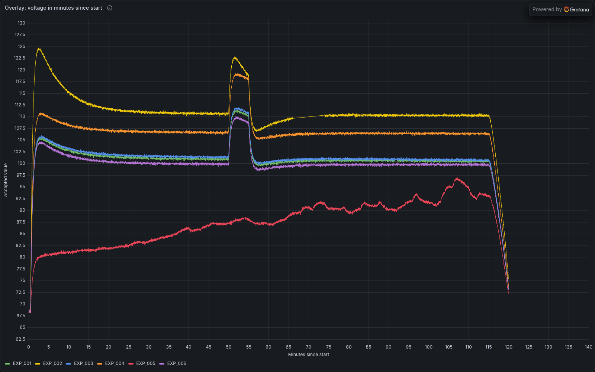
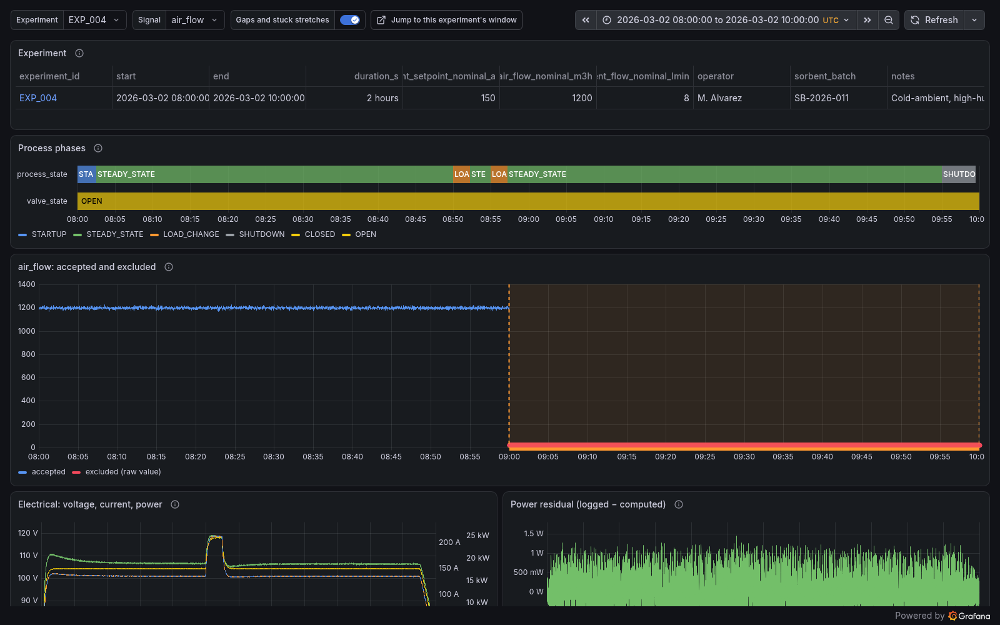

# DAC Process Data Pipeline

**A time-series platform that tells a scientist which numbers they can trust, and shows its
working.**

It takes raw, messy sensor data from a Direct Air Capture (DAC) pilot plant, keeps every
reading, labels each one accepted or excluded with a machine-readable reason, derives process
and energy metrics, and puts six experiments on one clock in Grafana. Nothing is silently
dropped. Nothing is silently fixed.



*Cell voltage for all six experiments, each starting on a different date, aligned on "minutes
since start" by the query itself. No copy of the data, no manual alignment.*

## The problem

A pilot plant logs sensors at 1 Hz for hours, for months. A historian export (PLC / OPC-UA)
arrives with gaps, stuck sensors, duplicate and out-of-order samples, mixed sample rates, and
quality flags that are present but not complete. A scientist wants to compare runs and
publish a number.

Most pipelines answer "can I load this?" This one answers a harder question: **"which of
these numbers can I defend, and why?"**

## What it does

| Stage | What happens | Proof it works |
|---|---|---|
| Ingest | Raw CSV to InfluxDB 3 Core. Duplicates resolved by content, re-runs are safe, raw file never edited. | 520,005 rows = 519,980 saved + 15 exact copies + 10 conflict losers + 0 rejected. All 150 series balanced against a count read back from the database. |
| Clean | A verdict per reading: raw value, processed value, flag, verdict and reason all kept. | 519,980 readings = 514,443 accepted + 5,537 excluded. Raw tables unchanged. |
| Derive | 13 metrics per experiment (energy, efficiency, capture rate and more), each labelled complete, partial or none. | Computed power cross-checked against the logged power signal: energy agrees within 0.67 %. Independent plain-Python recompute: 0 differences. |
| Compare | Six experiments on one experiment clock. Says which pairs can fairly be compared. | 1 supported pair, 14 confounded, named as such. Recompute: 0 differences. |
| Show | Two Grafana dashboards, provisioned read-only from committed JSON. | 3,105 panel queries run by a script across every experiment and signal: 0 errors. |

## What the pipeline found in the data

| Defect | Count in this dataset | How it is handled |
|---|---|---|
| Same-timestamp collisions | 25 groups (15 identical, 10 conflicting) | Resolved by content, loser kept in a conflicts table |
| Out-of-order rows | 30 | Time-sorted on write, counted before it is erased |
| Gaps | 29 | Marked and listed, never interpolated away |
| Stuck-sensor runs | 5 | Excluded, with a machine-readable reason |
| Impossible values / spikes | 4 / 4 | Excluded, raw value kept |
| Flagged BAD / UNCERTAIN | 100 / 230 | Excluded, flag kept |



*One example. After 09:00 the raw air flow in EXP_004 falls 98 %, while fan speed, pressure
drop, outlet CO2 and capture efficiency do not move. That fits a sensor fault, so those 3,600
readings are excluded. The dashboard draws them as red points so the exclusion is visible,
not hidden.*

## Design choices worth a conversation

Every non-trivial decision is one of 18 records in [`docs/decisions/`](docs/decisions/), each
with the rejected alternative.

**Raw values are never altered.**
[ADR-0006](docs/decisions/ADR-0006-timeseries-data-model.md) splits numeric and categorical
state into separate tables. InfluxDB 3 fixes a column's type on first write, and a state like
`valve_state` stored as an integer would let `mean(value)` return a number that looks fine and
means nothing. `quality` sits beside the value as a field, so "everything" and "only what is
trustworthy" are one `WHERE` clause apart.

**Retention has a monitored invariant, not just a TTL.**
[ADR-0011](docs/decisions/ADR-0011-retention-tiering-rollup.md) works from measured volume
(about 387 M points per plant-year) to four tiers: raw, 1-minute rollups, pinned intervals,
Parquet cold storage. The rule: rollup lag must stay below raw retention. If a rollup job
stalls silently, buckets freeze into permanent stale aggregates once raw data expires, while
every individual point still looks fine. That is why a rollup needs a heartbeat, not just a
schedule.

**Duplicate detection in bounded memory.**
[`pipeline/collisions.py`](pipeline/collisions.py) uses an external merge sort: sort chunks,
spill runs to disk, k-way merge. Memory is O(chunk + runs), not O(rows). It is a shared module,
so the census and the ingest path cannot drift apart.

**Calibrate before scaling.** Every cleaning and metric step was checked against an
independent plain-Python recompute on a sample before it ran at full scale. The recompute
imports nothing from the pipeline.

**Provisioned as code.** Compose stack, tokens, databases, retention, datasources and
dashboards all come from scripts and committed files. InfluxDB 3 Core has no default admin
token, so [`scripts/bootstrap_influx_token.py`](scripts/bootstrap_influx_token.py) mints one
idempotently. Local dev runs with auth on.

**It refuses to over-claim.** The brief asks how flow and pressure relate to cell voltage. The
draft answer in [`reports/findings.md`](reports/findings.md) is `not_resolved`: the intervals
are too wide, or the experiments disagree, for a claim either way. Every number in that file
is checked against the results file by a test.

## Quality bar

- 795 unit tests pass, plus integration and end-to-end suites that run against a live stack
  (they skip, not fail, if a container is down).
- Six JSON contracts (one per pipeline step's summary output) validated in CI. Dashboard JSON
  is linted; datasource references resolve.
- Every milestone ends with a report in [`reports/`](reports/): what was built, how it was
  checked, what was not.
- A [mistake log](docs/MISTAKES.md) records wrong calls at the moment they surfaced.

## Architecture

```
                 +----------------------+      +--------------+
  data/raw/      |  Ingest, clean,      |      | InfluxDB 3   |      Grafana
  *.csv -------->|  derive, compare     |----->| Core (SQL)   |----> 2 dashboards
  (immutable,    |  (Python, pure logic |      | raw | rollup |      (read-only JSON)
  gitignored)    |  split from I/O)     |      | | pinned     |
                 +----------+-----------+      +--------------+
                            |                         ^
                            v                         |
                    +---------------+          rollups over the
                    |  PostgreSQL   |          verdict, then Parquet
                    |  experiment   |
                    |  metadata and |
                    |  KPIs         |
                    +---------------+
```

- **InfluxDB 3 Core** for readings, queried by SQL over Arrow Flight.
- **PostgreSQL** for experiment metadata and comparison results: relational, low-cardinality,
  versioned by migrations.
- **Grafana** with two dashboards. *Compare experiments*: selector, KPI tables, which pairs can
  be compared, overlays, data quality. *Experiment detail*: phases, one signal with excluded
  readings as red points, gaps and stuck stretches. See [`docs/dashboard.md`](docs/dashboard.md).
- **Docker Compose** with pinned image tags. No manual setup step.

## Status

| Deliverable | State |
|---|---|
| Data model, ingestion, cleaning, metrics, comparison, dashboards | Built and verified against the real data set |
| Findings on flow and pressure against voltage | Draft, pending my review |
| Edge ingestion and resilience design, cloud scaling, walkthrough | Not started. Designed to follow the pipeline, so the plant-to-cloud story is written, not built. |

Known limits: one run per condition, so differences between runs cannot be separated from
day-to-day variation. Rollup over the full real data takes about 12 minutes and is not in CI.
The rollup-lag heartbeat is specified in the decision records, not implemented.

## Quick start

Requires Docker and Python 3.14.

```bash
git clone https://github.com/sebtum/dac-timeseries-pipeline.git
cd dac-timeseries-pipeline
python -m venv .venv && .venv/Scripts/activate   # or source .venv/bin/activate
pip install -r requirements.txt

python generator/generate_dataset.py             # writes data/raw/*.csv + experiments.json

# Start order matters: Grafana reads the InfluxDB token once, when it starts, so it comes last.
docker compose up -d influxdb postgres           # InfluxDB 3 Core + PostgreSQL
python scripts/bootstrap_influx_token.py         # mints INFLUX_TOKEN into .env
python -m scripts.migrate                        # Postgres schema (migrations 0001-0004)
python scripts/init_influx.py                    # creates raw/rollup/pinned databases
python -m scripts.load_experiments               # experiment metadata into Postgres
docker compose up -d grafana                     # Grafana, with both datasources and dashboards

python -m scripts.ingest                         # raw CSV -> InfluxDB
python -m scripts.clean                          # a verdict per reading
python -m scripts.metrics                        # derived metrics
python -m scripts.compare                        # comparison summary (reports/)
python -m scripts.load_comparison                # steady KPIs and pairs into Postgres

pytest                                           # unit tests always run; integration tests
                                                 # skip if a container isn't reachable
```

Open <http://localhost:3000> (`GRAFANA_PORT` in `.env`), sign in with `GRAFANA_ADMIN_USER` and
`GRAFANA_ADMIN_PASSWORD` from `.env`, and open the folder "DAC". Dashboards are read-only in
the browser by design; edit the JSON under `grafana/dashboards/`.

```bash
python -m scripts.check_dashboards --sweep signal --allow-empty "Gaps and stuck stretches"
                                                 # runs every panel query for every experiment
                                                 # and signal; writes reports/dashboard_check.json
python scripts/verify_stack.py up                # a private copy of the stack for verification
```

## If you have five minutes

| Look at | To see |
|---|---|
| [`docs/decisions/ADR-0011-retention-tiering-rollup.md`](docs/decisions/ADR-0011-retention-tiering-rollup.md) | Volume arithmetic turned into a design, with the failure mode named |
| [`docs/cleaning_policy.md`](docs/cleaning_policy.md) | 25 per-signal rules, checked against the code by a test |
| [`reports/findings.md`](reports/findings.md) | A result that says "not resolved" and shows why |
| [`reports/M3.md`](reports/M3.md) | What a milestone report looks like: built, checked, not done |
| [`docs/MISTAKES.md`](docs/MISTAKES.md) | Wrong calls, logged when they happened |

## Repository layout

```
task/            The brief (TASK.md) and per-signal reference (DATA_DICTIONARY.md).
generator/       Deterministic, seeded synthetic dataset generator (stdlib only).
data/raw/        Generated raw dataset. Never edited in place; only its SHA-256 is committed.
pipeline/        Processing logic (ingest, cleaning, rollup, metrics, comparison), split into
                 pure functions and thin database drivers so it is unit-testable.
scripts/         Operational scripts: provisioning, token bootstrap, the pipeline steps,
                 the dashboard checker and screenshots.
grafana/         Provisioning and the two dashboards as JSON.
migrations/      Versioned Postgres migrations.
contracts/       JSON schemas for each step's summary output, validated in CI.
docs/decisions/  Architecture decision records, with alternatives rejected.
docs/            Schema, cleaning policy, metric formulas, comparison method, dashboard guide.
reports/         One report per milestone, plus the profiling, cleaning, metrics and
                 comparison outputs.
tests/           Unit, integration and end-to-end tests.
```

## Documentation

- [`task/TASK.md`](task/TASK.md): the brief this was built against.
- [`docs/schema.md`](docs/schema.md): InfluxDB schema, measured cardinality, retention tiers.
- [`docs/cleaning_policy.md`](docs/cleaning_policy.md): the per-signal handling table.
- [`docs/metrics.md`](docs/metrics.md): every derived-metric formula.
- [`docs/comparison.md`](docs/comparison.md): how experiments are aligned and compared.
- [`docs/dashboard.md`](docs/dashboard.md): panels, variables, how quality is drawn.
- [`docs/ASSUMPTIONS.md`](docs/ASSUMPTIONS.md): assumptions made where the brief was silent.
