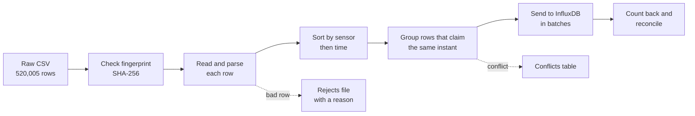

# M2 Ingestion: what was decided, and why (plain version)

Date: 2026-11-23   Milestone: M2   Deliverable: B (ingestion)

**In one line:** M2 copies the raw CSV into InfluxDB without losing or quietly changing anything, and proves that with counts. Nine choices were open. All nine are now decided. None is "major", so none needs your approval, but you can overturn any of them.

This is the first milestone under the new working model: Claude decides, you review. Each decision below starts with a plain summary. The precise reasoning sits under **Details**.

---

## The pipeline, start to finish

Two database behaviours explain most of what follows:

1. **Same identity means silent overwrite.** A point is identified by *table + sensor labels + timestamp*. Save a second point with the same identity and it replaces the first, with no error. This hurts with duplicates. It helps with re-runs: running the ingest twice ends in exactly the same state.
2. **Only the moment is kept, not how it was written.** `10:00+02:00` and `08:00Z` are the same moment. The database stores that moment in UTC (world reference time) and forgets the original text.

---

## D1. Timezones: trust the offset each row states

Each timestamp is converted to UTC using the offset written on it. I checked this against the experiment windows, and it is right for every source in every experiment.

Details: Three sources write `Z` (already UTC). The weather station (`ambient`) writes `+02:00`. Measured this session, with every row parsed honouring its offset:

| Source | Offset as written | First reading vs. experiment start | Last reading vs. experiment end |
|---|---|---|---|
| absorber, hydrolyzer, plant | `Z` | 0 s, in all 6 experiments | −1 s (last 1 Hz sample) |
| ambient | `+02:00` | 0 s, in all 6 experiments | −60 s (last 1-per-minute sample) |

If the offset were ignored and the text read as UTC, every ambient reading would land 2 hours late, outside its own experiment. So the offset is truthful here, and honouring it is correct.

Extra rules this adds:
- **A timestamp with no offset at all is rejected, not guessed.** "No offset" is ambiguous, and assuming UTC is exactly the silent fix the brief forbids.
- The `+02:00` is a fixed offset, not local clock time. Even the March experiment (`EXP_004`, before daylight-saving starts) says `+02:00`, and it still lines up. Worth knowing if anyone asks "what about DST?": the logger writes a fixed offset, and the window check proves it.
- The original offset text is not stored per point, which would add a column to all 520k rows. Instead, the ingest report records the offset seen per source, and the window check above runs on every ingest.

## D2. Time precision: store the exact instant, never round

Today every timestamp is whole seconds. Even so, the ingest writes the exact instant at the finest unit, so a future file with milliseconds is never silently rounded.

Details: 0 of 520,005 timestamps have a fractional second (measured). Writing in seconds would work today. The risk is a future file: rounding `10:00:00.3` and `10:00:00.7` down to `10:00:00` makes two different readings share one identity, and behaviour 1 silently deletes one of them. Writing the parsed instant exactly costs nothing, since the database stores nanoseconds internally anyway. Python's `datetime` holds microseconds, so the parser rejects any timestamp finer than that rather than truncating it.

## D3. Batching: about 10,000 points per call, one call at a time

Points are sent in groups of about 10,000, waiting for each answer before sending the next. That is roughly 53 calls in total.

Details:
- Waiting for each answer (synchronous) was chosen over the client's background mode. Background mode reports failures through callbacks after the fact, which makes "exactly how many rows were saved" hard to prove. The whole point of M2 is that proof.
- 10,000 is a common starting size, not a measured optimum. Execute times it, and the report records the throughput, as M2's checks require.
- The sort reuses the existing bounded-memory sort (`pipeline/collisions.py`, which sorts in 50k-row chunks on disk), so memory stays flat however big the file gets.
- Rows go to `readings_numeric` or `readings_state` by the declared list of text signals (ADR-0006).

## D4. Errors: nothing disappears quietly

A row that can't be read goes into a rejects file with its row number and the reason. The run still saves the good rows, but ends with a failure code. A failed send is retried, and if it keeps failing, the run stops.

Details:
- **Bad rows** (bad timestamp, missing offset, a number that won't parse, an unknown signal) go to `reports/ingest_rejects.csv` with row number and reason. Exit code is non-zero if there is even one. Today there are none (census: 0 unparseable, 0 empty values).
- **The count check gains a fourth term**, so rejected rows can't vanish from the arithmetic:
  `CSV rows = saved + exact copies collapsed + conflict losers + rejected`
- **Failed sends** are retried 3 times with growing waits. Retrying is safe because re-sending the same point just overwrites itself (behaviour 1). After 3 failures the run stops with an error, and re-running from the start is safe.
- **Server-side partial accept** (`accept_partial`, which saves the good lines of a batch and drops the bad ones) will be turned **off**. The ingest checks every row before sending, so a line the server refuses means a bug, and the whole batch should fail loudly. *Still to confirm against our running 3.11.2 container during Execute: so far it's only documented behaviour (lesson from mistake E-06).*
- **The file fingerprint is checked first.** If the CSV's SHA-256 doesn't match the committed one, nothing is written.

## D5. Which reading wins a conflict: a stated rule, and the winner is never trusted

When two different values claim the same instant, the better quality flag wins. If the flags are equal, the smaller value is kept. That tiebreak is deliberately arbitrary. The real judgment happens in cleaning (M3), which marks every conflicted instant as suspect.

Details:
- 10 real conflicts exist. In all 10, both rows have the same quality flag (`GOOD`), so the quality rule never decides anything on this file. The tiebreak decides all 10.
- Why not "the value closest to its neighbours"? Picking the plausible value is a **cleaning** judgment, and cleaning doesn't belong in ingest (mistake C-04: ingest lands data, it doesn't fix it). It belongs in M3, where the neighbours and the rules live.
- Why "smaller value"? It depends only on the values, not on which row came first in the file, which ADR-0007 forbids. Any content-only rule would do. Its arbitrariness is fine because nothing downstream trusts the winner.
- Bias check: "always keep the smaller" could pull averages down. It can't here: M3 flags all 10 instants with the reason `conflicting_duplicate`, so they're left out of trusted calculations, and both values stay in the conflicts table.
- Defense in one sentence: *"Ingest's job is to keep both readings and make a deterministic, content-based choice for the main table. Deciding which reading is physically right needs context, so that happens in cleaning, with a recorded reason."*

## D6. What counts as "the same value": compare as numbers, exactly

Two numeric values are the same if they're exactly the same number once read. Text signals (`OPEN`, `STARTUP`) are compared as text.

Details:
- **Not raw text:** `250.0` and `250.00` are the same reading written differently, and text comparison would call them a conflict.
- **Not "close enough":** any tolerance would quietly merge two readings that really differ. The right tolerance would also differ per sensor, so one number would be wrong for most of them.
- On this file all three methods agree (15 of 25 pairs are equal under each), so the choice changes no count today. It's stated anyway because the next file may not be so tidy.

## D7. Conflicts on text signals: store the exact text in the conflicts table

The conflicts table stores both readings exactly as the file wrote them, as text. That works for number signals and word signals alike, with no second table.

Details:
- There are 0 duplicates on `valve_state` or `process_state` today. But InfluxDB fixes a column's type on first write, so a float-only conflicts table would crash the day a word signal does conflict.
- Text columns (`value_kept_raw`, `value_discarded_raw`) solve that, and they're also more faithful: they hold what the file literally said, before any parsing. A query that wants numbers converts the text.
- This settles the question ADR-0007 left open ("a second table or string columns"). It is a choice ADR-0007 offered, not a reversal of it.

## D8. What the automated tests run on: a tiny hand-made file

CI (GitHub's automatic checks) runs the ingest on a small file of about 40 rows, committed to the repo, where every right answer is known in advance.

Details:
- The real CSV is too big and is deliberately kept out of git. Regenerating it in CI would test against data whose answers nobody wrote down.
- The fixture (`tests/fixtures/ingest_slice.csv`) is built by hand to contain one of each case: an exact duplicate, a conflict, an out-of-order row, both timestamp styles (`Z` and `+02:00`), a word signal, and a bad row. The expected reconciliation counts are written into the test.
- This closes the open question about CI test data (U-02), and matches the roadmap's existing "fixture slice" line.

## D9. Out-of-order rows: counted in the ingest report, not stored in the database

The ingest counts rows that arrive earlier than a reading already seen for the same sensor, and lists them in its report. They're not written into the database.

Details:
- Arrival order is about **transport** (how data travelled), not about whether a value is right. Once sorted, an out-of-order reading is a perfectly good reading. So it belongs in the run report, and later in the system-health story (deliverable H), not in per-value quality.
- The ingest already reads the file in its original order before sorting, so counting costs nothing. Expected: 30 rows, matching the census.

---

## How M2 will be checked (written before the code)

| Check | Passes when |
|---|---|
| Nothing lost | The 4-term count balances for every experiment and sensor, counted back from InfluxDB |
| Re-run safe | A second run leaves every count and the conflicts table unchanged |
| Raw untouched | The CSV fingerprint still matches the committed one |
| Time right | Every source's readings fall inside its experiment window (the D1 check) |
| Speed noted | Rows per second recorded in the report |
| CI | The hand-made fixture test passes in GitHub Actions |

## Still to come in the M2 report

- The owed review of two earlier pieces, the schema doc (T3) and the rollup function (T8).
- Whether `accept_partial` behaves as documented on our container.
- The measured throughput and the final counts.
